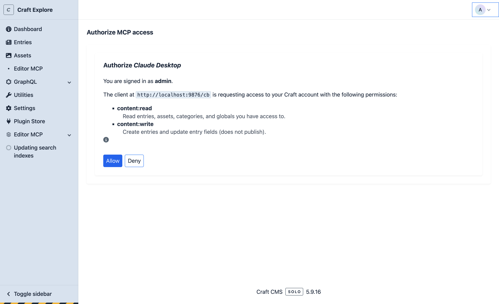
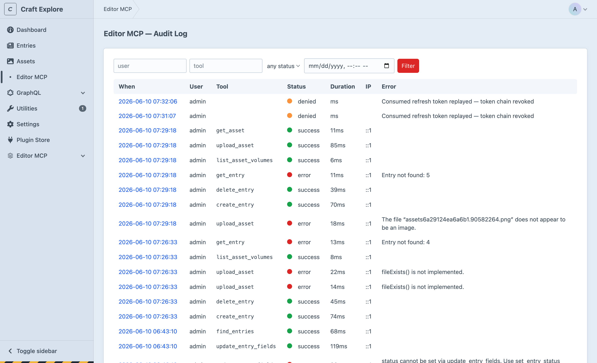
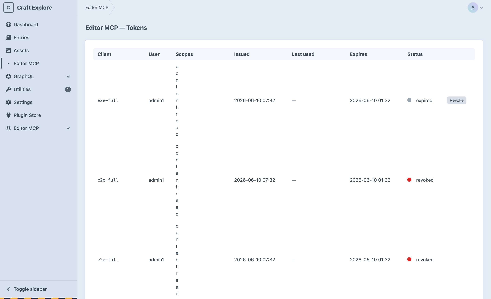
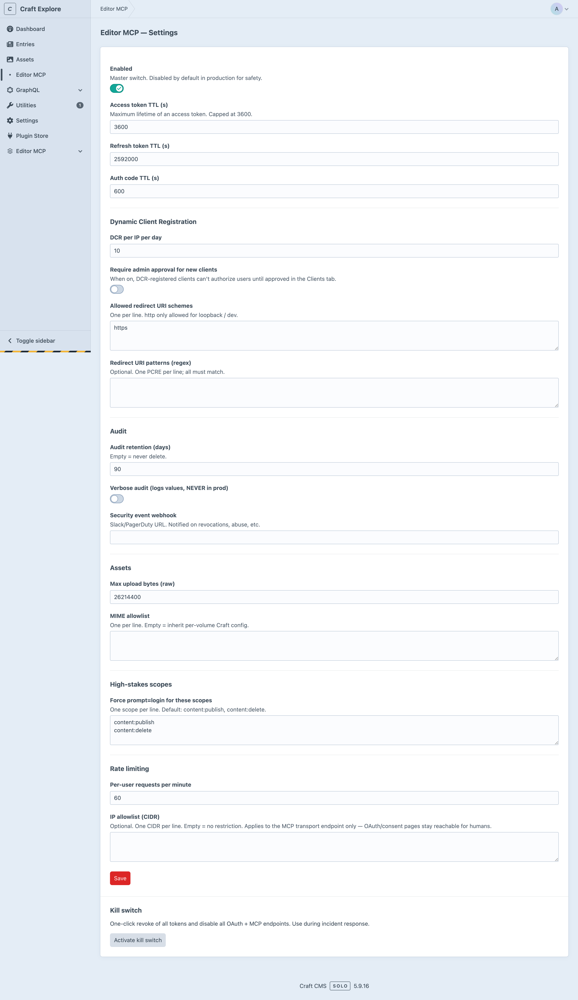

# Editor MCP for Craft CMS

Editor MCP adds a [Model Context Protocol](https://modelcontextprotocol.io) (MCP) server to your Craft site. AI assistants can then read and edit your content. Claude Code, Claude Desktop, Cursor, Codex, and other MCP clients are supported.

You connect an assistant one time through the usual Craft login. After that, the assistant acts **as you**. It can see and change only the content that your Craft account can see and change. Craft's permission system checks each action. You do not make API keys or service accounts, and the assistant gets no shell access.

- Craft 5.0 or later, and PHP 8.2 or later
- HTTPS and standard OAuth. The assistant opens your browser, you log in to Craft, and you approve the connection.
- 15 content tools for entries, assets, sections, categories, and globals

## Screenshots

| Authorize an assistant | Audit log |
|---|---|
|  |  |

| Connected tokens | Settings |
|---|---|
|  |  |

---

## Install

**From the Craft Plugin Store**

1. In the Control Panel, go to **Plugin Store**.
2. Search for **Editor MCP**.
3. Click **Install**.

**With Composer**

```sh
cd /path/to/your/craft/project
composer require westonhancock/craft-editor-mcp
php craft plugin/install editor-mcp
```

### Enable the plugin

The plugin is disabled after you install it. **Enabled** is the only setting that you must change. All other settings have safe default values.

1. In the Control Panel, go to **Settings → Editor MCP**.
2. Set **Enabled** to on.
3. Click **Save**.

Your MCP endpoint is your site URL followed by `/mcp`:

```
https://your-craft-site.example/mcp
```

---

## Connect your assistant

All clients use the same `/mcp` URL. In the examples below, replace `https://your-craft-site.example/mcp` with your endpoint.

When you connect for the first time, the procedure is the same for all clients:

1. The assistant opens your browser.
2. Log in to Craft. If your account uses 2FA, Craft asks for your code.
3. On the access screen, click **Allow**.

### Claude Code

1. Add the server:

   ```sh
   claude mcp add --transport http editor-mcp https://your-craft-site.example/mcp
   ```

2. Start Claude Code and run `/mcp`.
3. Select **editor-mcp**, then select **Authenticate**.
4. In the browser, log in to Craft and approve the connection.

### Claude Desktop

1. Go to **Settings → Connectors → Add custom connector**.
2. Paste your `/mcp` URL.
3. In the browser, log in to Craft and approve the connection.

If your version does not show custom connectors, use the [`mcp-remote`](https://www.npmjs.com/package/mcp-remote) bridge. Add this to `claude_desktop_config.json`:

```json
{
  "mcpServers": {
    "editor-mcp": {
      "command": "npx",
      "args": ["mcp-remote", "https://your-craft-site.example/mcp"]
    }
  }
}
```

Restart Claude Desktop. The browser login opens the first time that you use the server.

### Cursor

Go to **Settings → MCP → Add new MCP server**. You can also edit `~/.cursor/mcp.json`:

```json
{
  "mcpServers": {
    "editor-mcp": {
      "url": "https://your-craft-site.example/mcp"
    }
  }
}
```

Cursor opens the browser login when it connects for the first time.

### Codex CLI

Codex starts MCP servers as local commands. Use the [`mcp-remote`](https://www.npmjs.com/package/mcp-remote) bridge in `~/.codex/config.toml`:

```toml
[mcp_servers.editor-mcp]
command = "npx"
args = ["mcp-remote", "https://your-craft-site.example/mcp"]
```

Run Codex. The browser login opens the first time that you use the server.

> **Other MCP clients:** If the client supports remote HTTP servers, give it the `/mcp` URL. If the client supports only stdio, use `npx mcp-remote https://your-craft-site.example/mcp`.

---

## Tools

| Tool | Function |
|---|---|
| `list_sections` | Lists the sections in the site and the entry types of each section |
| `list_section_fields` | Lists the fields on the entry types of a section |
| `list_asset_volumes` | Lists the asset volumes that you can use |
| `find_entries` | Finds entries in a section by status, keywords, or slug |
| `get_entry` | Gets all content of one entry, with all custom fields. For a live entry, it also lists the drafts of that entry. |
| `create_entry` | Makes a new entry. The default is a draft. |
| `update_entry_fields` | Changes the title, slug, or custom fields of an entry. The changes go into a draft. The live entry does not change. |
| `set_entry_status` | Publishes, unpublishes, or disables an entry. When you publish a draft, the draft changes go live. |
| `delete_entry` | Moves an entry to the Craft trash. You can restore it from the trash. |
| `find_assets` | Finds assets in a volume |
| `get_asset` | Gets all metadata and the URL of one asset |
| `upload_asset` | Uploads a file (base64, 25 MB maximum) to a volume |
| `list_categories` | Lists the categories in a group |
| `get_global` | Reads a global set by its handle |
| `who_am_i` | Shows the connected user and the permissions of the connection |

### Permissions

When you approve a connection, you give it a set of permissions: read content, write content, publish, delete, and upload assets. The assistant can use only the permissions that you approve.

Craft also checks **each action against your Craft account**. If you cannot edit a section in the Control Panel, the assistant also cannot edit it.

The publish and delete permissions have more protection. If a connection asks for them, Craft asks for your password again before you can approve it.

---

## Usage

After you connect, give instructions to your assistant in plain language. Examples:

- “Who am I connected as?”
- “What sections does this site have?”
- “Find the five most recent entries in the `news` section.”
- “Show me the full content of entry 1234.”
- “Create a draft in `blog` titled *Spring Release Notes* with this body: …”
- “Update the `summary` field on entry 1234 to …”
- “Publish entry 1234.”
- “Upload this image to the `uploads` volume and set its alt text to …”

The assistant selects the tools. New entries are drafts by default. An entry is not published until you tell the assistant to publish it.

Changes to an existing entry also go into a draft, named "Editor MCP draft". The live entry does not change. If you ask for more changes to the same entry, the assistant adds them to the same draft. You can examine the draft in the Control Panel. To make the changes live, tell the assistant to publish the draft, or apply the draft in the Control Panel.

A connection with the publish permission can save changes directly to the live entry. The assistant does this only when you tell it to.

---

## Configuration

In the Control Panel, go to **Editor MCP**. The section has these pages:

- **Tokens:** Shows each connected assistant and when it was last used. You can revoke each token.
- **Clients:** Shows each registered OAuth client. You can approve or revoke each client.
- **Audit Log:** Shows a record of each action that the plugin did.
- **Settings:** Enables or disables the plugin, and changes optional limits.

The default values are safe. Most sites need only the **Enabled** setting.

### Keys on hosts that clear storage

The plugin uses two keys to sign and encrypt tokens. It makes these keys in `storage/editor-mcp/keys/`. Some hosts, for example Servd, clear `storage/` at each deploy. When the keys change, all connected assistants are signed out. Each user must then authenticate again.

To keep the same keys, move them into environment variables:

1. Print the current keys as env lines:

   ```sh
   php craft editor-mcp/keys/generate --from-storage
   ```

   With `--from-storage`, the command exports the keys that the site uses now. No user is signed out when you change to env vars. Without `--from-storage`, the command makes new keys.

2. Add the two printed lines (`EDITOR_MCP_PRIVATE_KEY` and `EDITOR_MCP_ENCRYPTION_KEY`) to your environment. Keep them secret.

3. Add references to them in `config/editor-mcp.php`:

   ```php
   <?php

   return [
       'privateKey' => '$EDITOR_MCP_PRIVATE_KEY',
       'encryptionKey' => '$EDITOR_MCP_ENCRYPTION_KEY',
   ];
   ```

If a referenced env var is not set, the plugin logs a warning and uses the keys in `storage/`. If a value is set but is not valid, the plugin shows an error. It does not make a new key.

You can set these two settings only in the config file. The Control Panel does not show them, and it does not write them to project config.

`privateKey` accepts raw PEM, PEM with `\n` escapes, or base64-encoded PEM.

---

## Limits

Editor MCP is only for content work. It does **not** give access to database queries, user management, plugin or system configuration, or code execution. For these tasks, use the Control Panel.

---

## Local development

Use a Composer path repository to symlink the plugin into a Craft site. Then your changes to the source are live at the next request.

1. In the `composer.json` file of the Craft site, add the path repository and the package:

   ```json
   {
     "repositories": [
       {"type": "path", "url": "../craft-cms-content-ops-mcp", "options": {"symlink": true}}
     ],
     "require": {
       "westonhancock/craft-editor-mcp": "@dev"
     }
   }
   ```

2. Install the package:

   ```sh
   composer update westonhancock/craft-editor-mcp
   php craft plugin/install editor-mcp
   ```

To examine the code, run these commands:

```sh
vendor/bin/phpstan analyse --memory-limit=1G   # static analysis
vendor/bin/ecs check                            # code style
vendor/bin/phpunit                              # unit tests
```

---

## Support

- **Issues:** https://github.com/westonhancock/craft-cms-content-ops-mcp/issues
- **Source:** https://github.com/westonhancock/craft-cms-content-ops-mcp

## License

This is commercial software. The [Craft License](LICENSE.md) applies. One paid license permits use in one production environment. For the full terms, see [LICENSE.md](LICENSE.md).
